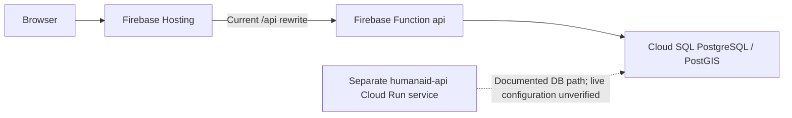

# HumanAid architecture recommendation

**Decision: retain Firebase Hosting → Function `api` for now.** Evaluate a separately staged Cloud Run API and private workers after the security fixes and database-role plan are proven. Sprint 0 does not modify production infrastructure or `firebase.json` routing.

Reviewed September 27, 2026. Statements marked observed come from the audit; recommendations and proposed controls are not claims about live infrastructure.

## Current evidence

| Evidence | Meaning and limit |
| --- | --- |
| `.firebaserc`, `firebase.json` | Project `gocasino-1ecc9`; Hosting serves `frontend/dist`; `/api/**` rewrites to Function `api`; backend source declares Node 20. |
| Frontend configuration and serving asset | `VITE_API_URL=/api`; live and local asset `index-BmD3rcgF.js` contained eight relative API base literals and no absolute Cloud Run/Functions URLs at audit time. |
| Read-only health probes | Hosting, Hosting `/api/health`, the Function endpoint, and the separately documented `humanaid-api` Cloud Run health endpoint returned HTTP 200. These checks do not prove authorization, database privileges, source revision, or every feature. |
| Function export and lockfile | The locked `firebase-functions` 7.0.2 root export resolves to v2. Local changes make the v2 import explicit and set memory/timeout options; this is not proof of a first-generation-to-second-generation migration. |
| Container artifact | `backend/Dockerfile` used Node 18 and ran `node src/server.js`. The listener was disabled for `NODE_ENV=production` at audit time; the local hardening now starts it when the file is the process entrypoint (`require.main === module`). The Node 18 Dockerfile still needs alignment with the Node 20 backend engine and staging verification before any container release. A healthy existing service does not prove it was built from these files. |
| Repository workflows | No repository-defined GitHub Actions or Cloud Build deployment workflow was found in the audited working tree, HEAD, or `origin/main`. External triggers were not inventoried. |

The historical README's Cloudflare/Let's Encrypt description and claim that Firebase Authentication was only planned did not match the examined application. Do not use those claims to design a release.



## Compare the two API choices

| Concern | Keep the current Function | Future dedicated Cloud Run API |
| --- | --- | --- |
| Change scope | Fits the existing export and Hosting rewrite; harden without moving traffic. | Requires a reproducible container, entrypoint review, identity/secrets setup, and a reviewed Hosting rewrite. |
| PostgreSQL pools | One bounded pool per warm instance; budget all active instances and revisions. | Same pool discipline is required; containers do not eliminate connection pressure. |
| Cold starts | Tune instance/concurrency settings only from measured latency and cost. | Also subject to cold starts; minimum instances can trade cost for reduced startup latency. |
| Workers | Separate scheduled/task functions are possible; do not put import loops inside interactive requests. | Private services or jobs provide a separate runtime and resource envelope for scheduled/batch work. |
| Secrets | Bind only the required managed secrets to the function. | Bind only the required managed secrets to each service/job identity and revision. |
| Release and rollback | Track backend release and Hosting release together; the current rewrite has no revision pin configured. | Immutable container revisions and controlled traffic rollout are useful, but a Hosting release and backend rollback still need a coordinated plan. |
| Operations and cost | Lowest immediate migration burden. | More explicit service/build/revision ownership; not automatically cheaper. |

Minimum instances are a latency/cost choice, not a guarantee against all restarts. Measure startup and warm-request latency before changing them. [Cloud Run minimum instances](https://docs.cloud.google.com/run/docs/configuring/min-instances), [Firebase function controls](https://firebase.google.com/docs/functions/manage-functions).

## Database connection budget

Keep one process-level `pg.Pool`, with bounded acquisition/idle time and a measured `DB_POOL_MAX` (the local configuration starts at 5). Do not open a new pool per request. Set maximum instances and worker concurrency together, including overlapping revisions during releases:

```text
API peak instances across revisions × API pool maximum
+ worker peak instances × worker pool maximum
+ migrations/operations/reserved connections
< the instance's reviewed PostgreSQL connection budget
```

A number such as 5 is a starting setting, not evidence that the existing Cloud SQL instance can support a chosen deployment size. Cloud SQL documents pooling and per-instance connection limits; inspect the actual database limits before rollout. Do not assume managed pooling is enabled or available on the current edition. [Manage connections](https://docs.cloud.google.com/sql/docs/postgres/manage-connections), [Cloud Run connections](https://docs.cloud.google.com/sql/docs/postgres/connect-run), [managed pooling requirements](https://docs.cloud.google.com/sql/docs/postgres/managed-connection-pooling).

Use an attached Cloud SQL connection/socket or a reviewed connector/network route. The runtime service account needs narrowly scoped Cloud SQL access; the PostgreSQL login independently needs SQL grants. Neither permission replaces the other. See [the database role runbook](docs/DATABASE_APP_ROLE_RUNBOOK.md).

## Interactive requests and future workers

Firebase Hosting has a 60-second request timeout for rewritten Cloud Run responses. Increasing backend timeout alone does not extend the Hosting request window. Keep interactive responses short and return a job/status identifier for long work. A future `run` rewrite can use `pinTag` to associate the backend revision with a Hosting release, subject to documented tag limits; it is not configured here. [Hosting and Cloud Run](https://firebase.google.com/docs/hosting/cloud-run).

Proposed verification/import flow:

```text
Cloud Scheduler (OIDC-authenticated request)
  → private coordinator
  → bounded Cloud Tasks queue
  → private verification/import worker
  → isolated raw records and review proposals
```

Scheduler initiates work; Tasks handles queued per-record work and rate limits. Use dedicated invoker/enqueuer/worker identities, explicit audiences, idempotency keys, retry ceilings, and a failure-review queue. Put long batch processing in an appropriate job rather than exceeding HTTP delivery deadlines. These are proposed controls; no schedule or queue is created. [Scheduler authentication](https://docs.cloud.google.com/run/docs/triggering/using-scheduler), [Cloud Tasks integration](https://docs.cloud.google.com/run/docs/triggering/using-tasks).

Workers must not share a database superuser or arbitrary external-fetch access with the public API. Apply source allowlists, the SSRF boundary, response limits, source-specific budgets, and data licensing rules. AI-generated observations cannot mark a fact human-verified.

## Secrets and service identities

Use separate development, staging, and production identities and secret versions. Keep private API keys and database passwords in Secret Manager; grant access on each needed secret to the runtime identity, not a broad project-wide role. Do not ship administrative service-account JSON in source or container images.

For Firebase Functions, declaring a secret is not enough: bind it to the function that uses it. For Cloud Run environment-secret references, pin a specific version for a reproducible revision. Record secret version IDs with release metadata, never values. Provisioning/binding is a later operator step; changing a local `.env` file is not managed-secret deployment. [Functions environment and secrets](https://firebase.google.com/docs/functions/config-env), [Cloud Run secrets](https://docs.cloud.google.com/run/docs/configuring/services/secrets).

## Cost evaluation

Compare measured request volume, CPU/memory duration, concurrency, warm-instance settings, builds/artifacts, Cloud SQL capacity/storage, logs, network traffic, task/scheduler work, and external verification/AI usage. Cloud SQL and retained warm capacity may matter more than invocation counts. No current billing data or cost advantage was established by this audit. Establish staging budgets/alerts and bounded worker rates before deciding to migrate; do not select a runtime from an assumed free tier.

## Staging and promotion plan — not executed

1. Complete owner credential rotation and review the security diff. Identify the immutable source revision and capture existing release/configuration metadata without secrets.
2. Create an explicitly authorized staging environment with separate Firebase project/auth users, Cloud SQL data, runtime identity, secrets, and external-service limits. Use synthetic fixtures. A Hosting preview by itself does not isolate an API or database.
3. Consolidate and compare the database schema. Resolve both app-role compatibility gates in the database runbook: sync must use a reviewed safe default, and administrator changes need a separate operator path. Test allowed operations and denied privileges against the actual staged PostgreSQL/PostGIS versions.
4. Inventory every public backend entrypoint, including direct Function URLs and the separate `humanaid-api` Cloud Run service. Before declaring production secured, a separately authorized release must harden and test each active endpoint or deliberately restrict an obsolete endpoint. Changing the Hosting rewrite alone does not close other public paths. Stage the hardened Function first. Exercise public search/map/details; 401/403/admin paths; user isolation; submissions/reports; analytics; SSRF attempts; and browser flows. Record connection pressure, latency, and failure rates.
5. If Cloud Run is still justified, build a reviewed container from the same source. Start on the supplied `PORT` under production settings; match the Node engine; verify `/api` path handling and Firebase token authorization through both direct and Hosting routes. Review ingress and invocation policy: a public API still needs endpoint authorization; private workers must require service identity.
6. Test with isolated staging Hosting routing. Compare responses, identity handling, CORS, pool behavior, and rate limiting across both API paths. Rate limits held only in process memory do not provide a fleet-wide quota; decide whether a shared mechanism is needed.
7. Prepare a promotion record with exact Hosting release, backend revision/image, secret versions, database compatibility, owner sign-off, metrics, and rollback triggers. Only a later explicit release instruction can move production traffic.

## Rollback and retirement

For a future Cloud Run trial, deploy a revision without sending normal traffic first, then use a reviewed traffic rollout. Reassign traffic to a known-good revision if error/latency/authorization gates fail. A rollback does not reverse database writes; use additive/backward-compatible schema changes and suspend workers if necessary. [Cloud Run rollouts and rollbacks](https://docs.cloud.google.com/run/docs/rollouts-rollbacks-traffic-migration).

For a future Hosting rewrite change, retain a known-good Hosting release and record which backend it expects. Restoring only the frontend is insufficient if the backend contract changed. Keep the Function available until the new route passes an agreed observation window. Do not delete the existing Cloud Run service or Function as cleanup in Sprint 0.

Never roll back to an exposed database password or reintroduce a production superuser login to the public API. Use a compatible known-good application release with the restricted identity, or stop the affected feature while an operator reviews the failure.
